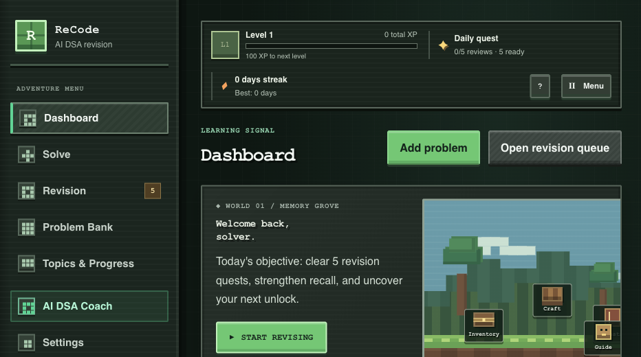
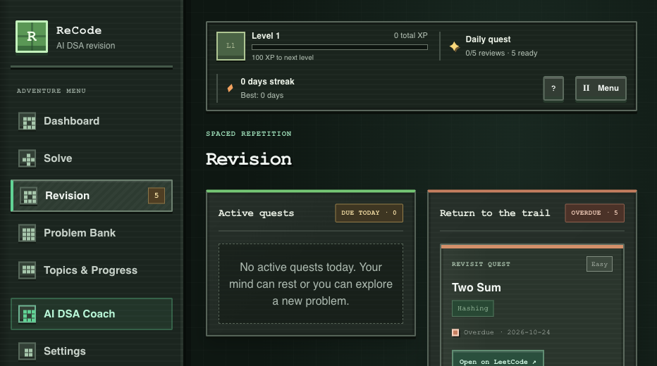
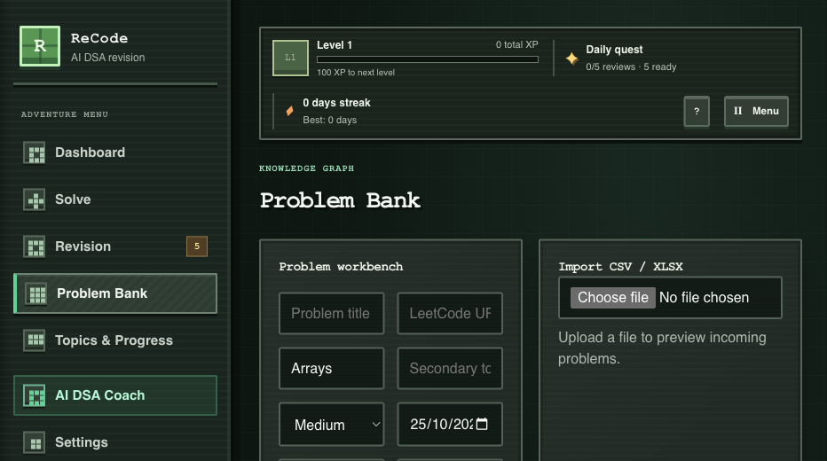
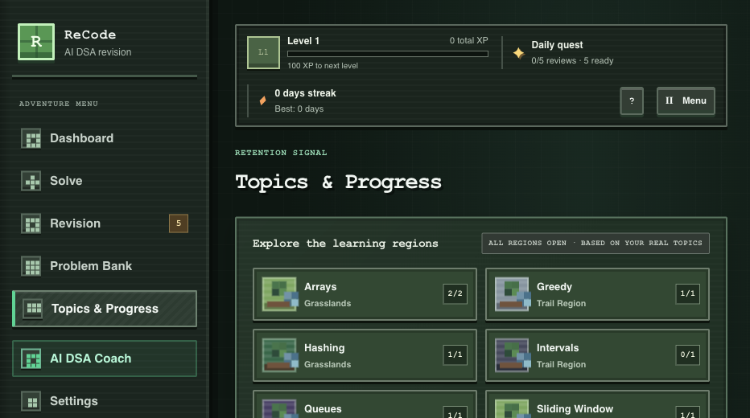
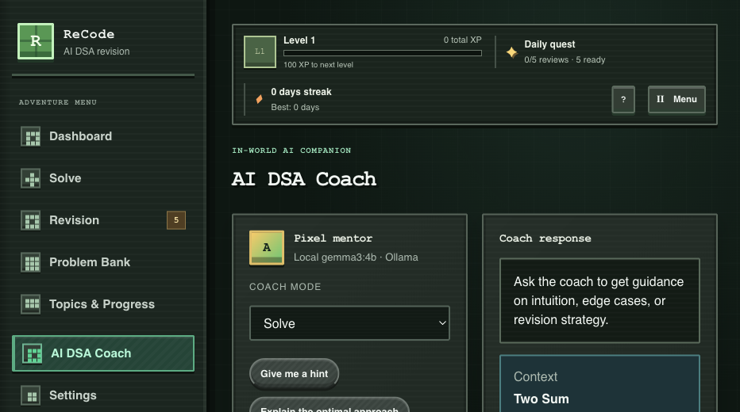
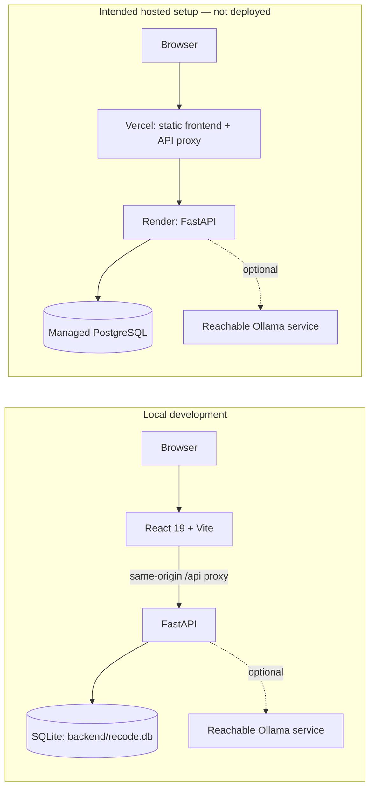

# ReCode

**A voxel-inspired DSA study world for saving problems, revisiting them on a real schedule, and learning from your own recall.**

<p align="center">
  
</p>

ReCode turns spaced repetition into a small adventure: your saved problems become inventory, reviews become quests, and progress is earned from completed study—not simulated gameplay. Its forest-world artwork and block-built interface are original CSS illustrations; ReCode is not affiliated with Minecraft or Mojang.

> Screenshots show the app running locally with its development sample problems. They are genuine captures of the working UI, not a static mockup.

## At a glance

- **Study dashboard:** real problem, due/overdue, topic, difficulty, weekly activity, and player-profile data.
- **Problem Bank:** search and sort saved problems, filter by topic, difficulty, and revision state, inspect a selected problem, and open its LeetCode page.
- **Revision quests:** rate recall as *Easy*, *Struggled*, or *Forgot*; completion updates the schedule, review history, XP, streak, and milestones.
- **Solve workflow:** record a problem, topic, difficulty, solve date, notes, and complexity; import CSV/XLSX files with a preview.
- **Topic regions:** explore statistics derived from tracked topics and secondary tags. Topic totals can overlap.
- **AI DSA Coach:** optional Ollama-powered hints, approach explanations, complexity discussion, and recall questions with selected-problem context.
- **Settings and export:** tune revision intervals and daily goal, set a preferred language/model label, and export saved problems, review events, and game profile as JSON.

## Screenshots

| Revision quests | Problem inventory |
| --- | --- |
|  |  |

| Topic regions | AI companion |
| --- | --- |
|  |  |

## How progression works

- The default review intervals are **1, 3, 7, and 14 days**; they can be changed in Settings.
- An **Easy** review advances to the next configured interval. **Struggled** and **Forgot** schedule a one-day retry.
- A problem can be reviewed once per calendar day. Each completed review earns **20 XP**; levels advance every **100 XP**.
- Milestones are awarded for 1, 5, and 25 completed reviews, plus a three-day review streak. XP, streaks, achievements, and historical review events are stored in the configured database.
- A missed day does not erase the review history or schedule. The daily target is a planning aid, not a penalty.

## Start locally

On macOS, install Python 3.11.11, Node.js 20.19+ (or 22.12+), npm, and `curl`. From the project directory:

```bash
./scripts/dev-macos.sh
```

The launcher creates missing local dependencies, starts FastAPI and Vite, checks readiness, and shuts both down with **Ctrl-C**. Open <http://127.0.0.1:5173>. For separate Terminal commands, environment variables, and troubleshooting, see [Development setup](docs/development.md).

## Architecture



The React/Vite frontend calls `/api` endpoints. The local Vite proxy forwards those requests to FastAPI; the included Vercel function is intended to proxy them in a hosted setup. SQLAlchemy stores problems, revision events, settings, and the game profile. SQLite is the local default; PostgreSQL is supported by the deployment configuration.

## AI coach

The coach uses the Ollama HTTP API and defaults to `gemma3:4b`. It can include the selected problem's title, topic, difficulty, saved notes, URL, and complexity fields in a prompt. AI output is explicitly fallible and is not used as the source of truth for progress or scheduling.

Install Ollama and pull the default model to try local inference:

```bash
ollama pull gemma3:4b
```

Model availability depends on the Ollama service and configured model. A hosted backend cannot reach Ollama running only on your Mac; it needs a separately reachable service configured with `OLLAMA_BASE_URL`. The app remains usable without AI.

## Deployment status

Vercel, Render, PostgreSQL, and private single-password deployment scaffolding are present, but **ReCode has not been deployed**. There is no verified live URL or hosted database, and the external deployment path has not been smoke-tested. See the [deployment guide](docs/deployment.md) for the intended setup and its required secrets.

The production configuration is for one private user, not a multi-user service. Local development uses SQLite and does not require the production password screen. Production disables demo seeding and requires the configured password/session secret.

## Data and privacy

- Local records are stored in `backend/recode.db` by default; `DATABASE_URL` can point to another SQLite file or a PostgreSQL database.
- Local development seeds sample problems only when the database is empty. Production configuration disables that seed data.
- JSON export includes problems, revision history, and the game profile. CSV/XLSX import adds problem records; it does **not** restore exported review history or XP.
- LeetCode links open externally. ReCode does not sign into LeetCode, sync an account, or scrape problem pages.
- If enabled, the AI coach sends the prompt and selected saved-problem context to the configured Ollama service. Keep private notes in mind when choosing where that service runs.
- Back up the database or export before changing or replacing it. The app is designed for a single user and does not provide multi-user account isolation.

## Contributing

See [CONTRIBUTING.md](CONTRIBUTING.md) for the current development checks and contribution notes. **No `LICENSE` file or reuse license has been selected yet**; do not assume that the code is licensed for redistribution. Choosing and adding a license is an open project decision.

## Roadmap

- Choose and add a license before presenting the project as open-source software.
- Deploy the Vercel + Render + PostgreSQL configuration and verify it with real hosted services.
- Add automated backend and end-to-end tests for persistence, revision completion, imports, and authentication.
- Expand problem editing and deletion controls in the frontend; the backend already exposes CRUD endpoints.
- Verify an actual Ollama inference against the configured model and document a secure hosted-coach option.

## Stack

| Layer | Current implementation |
| --- | --- |
| Frontend | React 19, TypeScript, Vite 8, custom CSS |
| API | FastAPI, Pydantic, SQLAlchemy |
| Local database | SQLite |
| Hosted database path | PostgreSQL via psycopg |
| Import | pandas, openpyxl |
| Optional AI | Ollama HTTP API; default model `gemma3:4b` |
